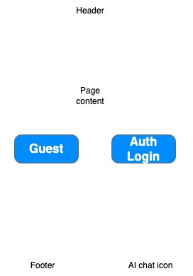

# voyage-project-learning-path-gen
Voyage Project - Learning Path Generator

## Table of Contents

* [Overview](#overview)
* [General Instructions](#general-instructions)
* [Requirements & Specifications](#requirements-and-specifications)
* [Stretch Goals](#stretch-goals)
* [Acceptance Criteria](#acceptance-criteria)
* [Acknowledgements](#acknowledgements)
* [About Chingu](#about-chingu)

## Overview

Hi, Chingus! 👋

You've probably had that moment of staring at a new career goal and wondering: *where do I even start?* Whether it's breaking into web development, leveling up to a senior engineer, or pivoting into data science, the sheer number of tutorials, courses, and roadmaps out there can be overwhelming. Here, you will gain experience by working on simulated teams while creating real projects.

In this Voyage, your team will design and build an **Event Planner** — a web application that uses AI to provide organizations with advanced qualitative and quantitative analytics and insights to gauge event performance as well as identify areas for improvement for future events. These analytics will enable companies to enhance their sales and marketing strategy in order to grow its customer base.

This is a great project because it combines thoughtful prompt engineering, full-stack development, and UI/UX design — all skills you'll use throughout your career as a web developer. You'll work with AI APIs to generate meaningful, structured content, design an interface that makes complex information easy to navigate, and collaborate as a team to bring it all together.

Your goal is to create an app that's genuinely useful, easy to understand, and something you'll be proud to show off in your portfolio!

## General Instructions

This project is designed to be worked on by a **team** rather than an
individual Chingu. This means you and your team will need to thoroughly read
and understand the requirements and specifications below, ***and*** define and
manage your project following the *Agile Methodology* described in the
[Voyage Handbook](https://github.com/chingu-voyages/Handbook/blob/main/docs/guides/voyage/voyage.md#voyage-guide).

As you create this project, make sure it meets all of the basic requirements.
Once you've reached your **Minimum Viable Product (MVP)** state, start
implementing the optional stretch goals — or get creative and extend it in ways
we haven't even thought of yet! In other words, use the power of teamwork to
make your version distinctive and unique.

A few things to keep in mind:

* **UI/UX creativity is yours to explore** — design an interface that stands
  out while still being easy to use. There is no single "right" way for the
  app to look.
* **No paid subscriptions or software are required** for this project. All
  tools and resources you need are free.
* You may use AI for **research and learning**. However, you may ***NOT*** use
  AI to write the code for your app. The code must be written by your team.

There are many [web hosting services](https://github.com/chingu-voyages/Handbook/blob/main/docs/resources/techresources/appdeployment.md)
with free tiers you can use to deploy your app.

## Requirements and Specifications

### What You Need to Do

The sections below describe what your team needs to build. The
**Basic Requirements** are the minimum features needed to have a working app
(your MVP). The **Stretch Goals** are extra features for teams that finish
early or want an extra challenge — they are completely optional.

> 📌 **Tier Note:** Basic Requirements are designed for **Tier 1** Voyagers
> (Beginner Frontend). Stretch Goals are designed with **Tier 2** and
> **Tier 3** Voyagers in mind, but any team is welcome to try them! A few
> individual items below are called out as required only for specific tiers —
> look for the tier note next to that item.

**Make sure you control the scope** so you'll be
able to complete the basic requirements by the end of the Voyage. Remember, you can always
add optional items and enhancements once you've completed the basic app.

#### Structure

* [ ] This can be implemented as a frontend application for Tier 1 & Tier 2. Tier 3 teams must implement both a frontend and a backend — see [Backend / Full-Stack](#backend--full-stack-required-for-tier-3) below for the minimum backend expectations.
* [ ] You may use any languages, tools, or libraries your team agrees on to design and build this app.
* [ ] Your app must be **deployed** to a hosting service so it can be accessed
  through the Internet. Free hosting options include
  [GitHub Pages](https://pages.github.com/),
  [Netlify](https://www.netlify.com/),
  [Vercel](https://vercel.com/), or
  [Render](https://render.com/).
* [ ] Your GitHub repo must contain a well-written `README.md` file that describes
  your app and includes the link to the deployed version.
* [ ] Navigation options (as applicable)

  * **Home** - displays the landing page when clicked
  * **Results** - displays event insights and AI analytics

* [ ] Screens

  * Home Screen (example of a very basic outline. Intentionally left vague because we want to see what you create)

    

    * Content that advertises the purpose of the app and its benefits

    **_Optional:_** user authentication is not required for the MVP — see [Stretch Goals](#stretch-goals) if your team wants to add it. However, there needs to be a guest log in that allows for a trial use of the application.

  * Results Screen (design is intentionally left open for your team to define — it should display event data such as attendance, revenue, etc.).

* [ ] User Interface and Experience (UI/UX)

  * In general, you will find these [UI design principles](https://www.justinmind.com/ui-design/principles) helpful.
  * If your team doesn't include a dedicated UI/UX Designer you will [find these tips](https://github.com/chingu-voyages/Handbook/blob/main/docs/resources/techresources/uiux.md)
    helpful.

#### Styling

* [ ] Surprise us!!! Use your team's creativity to make this app distinctive.
* [ ] Your app should be **visually clean and easy to read**. Think about contrast,
  font size, and spacing so that all users can comfortably use the app.
* [ ] Every page (or screen) should include:
  * A **header** with the name of your app.
  * A **footer** with a link to your team's GitHub repository.
* [ ] Your app should look good on both **desktop and mobile** screen sizes
  (responsive design).
* [ ] If your team includes a UI/UX Designer, they should create wireframes for
  each screen before the team starts coding. Refer to the Chingu Handbook's
  [UI/UX tips](https://github.com/chingu-voyages/Handbook/blob/main/docs/resources/techresources/uiux.md)
  for guidance.
* [ ] Recommended resource for [clean CSS](https://israelmitolu.hashnode.dev/writing-cleaner-css-using-bem-methodology).

#### Functionality

* [ ] Application Overview

  * Teams will have to decide on how best to store data as needed. Browser's Local Storage is a good option. You could also use free tiers from Firebase or Supabase.
  You can surprise us by adding more as your team decides.

### Basic Requirements (MVP)
These are the features your app **must** include. Think of them as the rules of
the voyage — without them, the app isn't really an Event Planner!

#### User Input
* [ ] The app must include a guest log in that allows prospective organizations to trial the app (Tiers 2 & 3).
* [ ] The app must include a section that allows organizers to create and edit an event by including information such as name, date, time, location, description, and expected attendance (Tiers 1 - 3).
* [ ] The app must allow for the managing of attendee list - add attendee names, edit details, search by name or registration ID (Tiers 1 - 3).
* [ ] The app must have a mechanism for recording check ins - mark attendee as checked in, prevent duplicate check ins, and allow accidental check ins to be reversed (Tiers 1 - 3).
* [ ] Input fields should have clear labels and placeholder text so users know
  what kind of information to enter (Tiers 1 - 3).

#### AI Requirements 
* [ ] The app must send the user's input to an **AI API** to provide post-event analysis including size, demographics, and revenue, etc. (Tiers 1 - 3)
* [ ]  AI must be able to create a summary and compare event data against expected attendance. (Tiers 1 - 3)
* [ ] Organizers must be able to specify target audience, event purpose, tone, and preferred call to action. (Tiers 2 & 3)
* [ ] Application must be able to generate a promotional copy by creating an email subject and body along with a short social media caption using event details. (Tiers 2 & 3)
* [ ] Application must be able to preserve confirmed event information by including correct date, time, location, and registration link. (Instead of inventing information, the app should ask for missing information.). (Tiers 2 & 3)
* [ ] Organizers must be able to edit the draft or request changes such as “make it shorter” or “use a friendlier tone.” (Tiers 2 & 3)
* [ ] The app must maintain an event history by storing completed events and allowing organizers to select at least two events for comparison. (Tier 3)
* [ ] The application must be able to compare registrations, actual attendance, attendance rates, and performance against each event’s target. (Tier 3)
* [ ] The app must be able to capture promotional sources by recording an optional “How did you hear about this event?” (Use consistent options such as email, social media, 
referral, etc. (Tier 3)
* [ ] The app must compare turnout by source by showing registrations and check ins associated with each promotional source. It must also include an “unknown” category for missing responses. (Tier 3)

## Stretch Goals
Once you complete the basic application, you may enhance it with any of the following optional stretch goals. Make sure that any of these you choose matches the capabilities of your team.

> These features are designed with **Tier 2** and **Tier 3** skill levels in
> mind, but any team is welcome to try them. Make sure to add acceptance
> criteria to your repo's `README.md` for any stretch goals you implement.

#### Account, Personalization & AI Q&A

* [ ] Authenticate users via Google or GitHub to enhance your app's security.
* [ ] The app is already AI powered — use it to provide attendees with **follow-up survey** after the event ends. The
  [Gemini Flash 1.5 free tier](https://ai.google.dev/pricing#1_5flash) is
  sufficient for this.

#### Event Promotion

* [ ] **Enhanced Automated Promotion** — the application automatically sends event information to past attendees based on geographic location (e.g. Organizer has an event in Dallas. Application sends event information to past attendees in Dallas and surrounding locations).

#### Event Performance Insights

* [ ] **Quantitative Analysis** — Allow organizers to observe trends in event data over a selected period of time.

#### Event Ratings

* [ ] **User Experience** — Allow AI to collect data on user experience, provide a summary, as well as suggest ways to improve user experience for future events.

## Acceptance Criteria

Your finished project should meet all of the following minimum standards:

* [ ] Your GitHub repo contains a well-written `README.md` that includes a link
  to your deployed app, a description of the project, and the names/GitHub
  profiles of all team members.
* [ ] The deployed app is accessible and fully usable in a modern web browser
  without any console errors.
* [ ] The UI is responsive and usable on both desktop and mobile screen sizes.
* [ ] If your team implemented any stretch goals, add their acceptance criteria
  directly to your repo's `README.md`.

## Acknowledgements

We would like to express our profound gratitude to the global developer
community, whose collaborative spirit and shared knowledge continually
motivate and enrich our endeavors. Together, we achieve extraordinary
milestones. Thank you.

## About Chingu

If you aren't yet a member of Chingu we invite you to [join us](https://chingu.io).
We help our members transform what they've learned in courses & tutorials into the
practical experience employers need and want. The experience that helps to set you
apart from other applicants for the same jobs.
